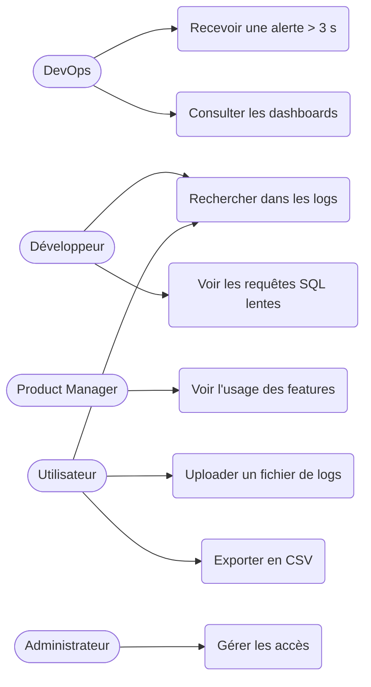

# Analyse fonctionnelle

## 1. Contexte et scénario choisi
Scénario D : application Web SaaS utilisée par des milliers d'entreprises clientes.
Les logs sont dispersés, sans alerting ni visualisation. La plateforme les centralise
et les rend exploitables.

**Justification du choix :** (à rédiger, 3-4 lignes)

## 2. Application SaaS monitorée : TaskFlow
SaaS fictif de gestion de projets. Les logs sont simulés avec un script Faker.
- Services : auth-service, project-service, billing-service, notification-service
- Endpoints : POST /api/login, GET /api/projects, POST /api/tasks, GET /api/reports,
  POST /api/invoices, GET /api/export
- Features : create_task, kanban_board, gantt_chart, export_pdf, team_chat, time_tracking
- Clients : entreprises fictives (champ `tenant`)

## 3. Les 5 types de logs
1. Serveur web (Nginx : accès, erreurs)
2. Applicatifs (Flask : exceptions, warnings)
3. Base de données (requêtes lentes, deadlocks, erreurs)
4. Performances (temps de réponse, CPU, mémoire)
5. Usage métier (features utilisées, actions utilisateurs)

## 4. Acteurs
- DevOps : surveille, reçoit les alertes
- Développeur : analyse les erreurs et les requêtes SQL lentes
- Product Manager : suit l'adoption des features
- Administrateur : gère les accès

## 5. User stories
- En tant que DevOps, je veux être alerté si le temps de réponse dépasse 3 s, afin d'intervenir avant l'impact client.
- En tant que développeur, je veux voir les requêtes SQL les plus lentes, afin de les optimiser.
- En tant que PM, je veux voir les features les plus et les moins utilisées, afin de décider quoi améliorer.
- En tant qu'utilisateur, je veux uploader un fichier de logs (CSV/JSON/TXT), afin qu'il soit indexé.
- En tant qu'utilisateur, je veux rechercher avec des filtres (niveau, service, dates), afin de diagnostiquer un incident.
- En tant qu'utilisateur, je veux exporter les résultats en CSV, afin de les partager.

## 6. Règles métier
- Seuil d'alerte : temps de réponse > 3000 ms
- Niveaux de log : DEBUG, INFO, WARNING, ERROR, CRITICAL
- Formats acceptés : CSV, JSON, TXT ; taille max 100 Mo
- Pagination des résultats : 50 par page

## 7. Diagramme de cas d'utilisation

