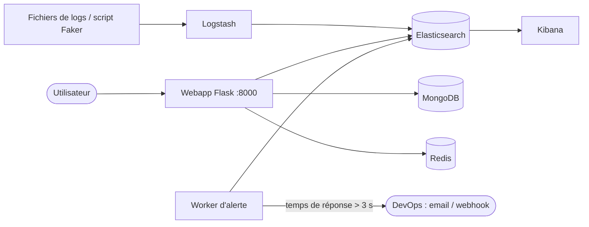

# Architecture technique

## Schéma des conteneurs

## Services Docker
elasticsearch, logstash, kibana, mongodb, redis, webapp (+ worker d'alerte au Sprint 3).
Réseau bridge, volumes de persistance, depends_on et healthchecks.

## Choix techniques
- Framework web : Flask 3.x (à justifier : léger, rapide à mettre en place pour API + interface).
- Alerte > 3 s : worker Python qui interroge Elasticsearch périodiquement, notification par email ou webhook.
- Ressources : Elasticsearch en nœud unique, heap limité (`ES_JAVA_OPTS=-Xms1g -Xmx1g`).

## Modèle Elasticsearch (ébauche, index template `logs-*`)
| Champ | Type |
|-------|------|
| @timestamp | date |
| log_type | keyword |
| level | keyword |
| service | keyword |
| endpoint | keyword |
| status_code | integer |
| response_time_ms | float |
| duration_ms | float |
| query | text |
| user_id | keyword |
| tenant | keyword |
| feature | keyword |
| action | keyword |
| message | text |

## MongoDB
- `files` : nom, taille, date_upload, statut, nb_logs
- `searches` : requête, filtres, date, user

## Redis
- `kpi:*` : cache des KPI (TTL 60 s)
- sessions utilisateurs, rate limiting
